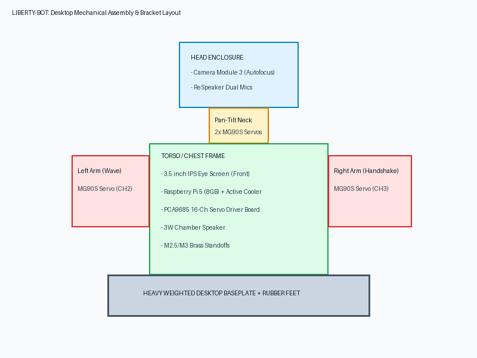
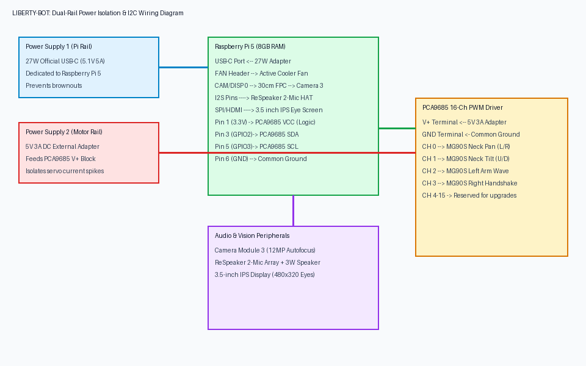

# November 14: Figuring out what is actually possible to build at home

Today I spent a lot of time figuring out what kind of hardware project I could genuinely build from scratch without getting stuck halfway through.

To be honest, my first thought was trying to build my own custom laptop or even a custom Android phone. I have been using an old Samsung phone for years, and when I take it to college, people often joke about how outdated it is. So at first I thought: why not use a hardware grant to build my own phone or laptop?

When I dug into the actual engineering requirements, I realized why nobody builds a daily-driver smartphone on a workbench at home. First, high-end laptop processors like AMD Ryzen or Intel Core chips cannot even be bought individually or soldered without factory BGA robots and 12-layer motherboards. Second, for a phone, DIY cellular modules do not have telecom IMEI approvals for Indian VoLTE networks (like Jio or Airtel), and uncertified boards are blocked by Google Play Integrity, meaning basic apps like WhatsApp, UPI, or Play Store will not even run on them. Even if I wired a screen and battery to a board, it would end up being a thick brick that dies in 45 minutes.

That realization actually helped me a lot. Instead of chasing something impossible that would fail, I thought about what I really wanted on my study table every day: a real desktop robot. Something that does not need a SIM card because it connects to my home Wi-Fi, stands right on my study table, looks at me and my books through a camera, talks back to me in a real voice when I ask questions about my subjects or projects, and moves its head and arms when I interact with it (like raising its arm when I ask for a handshake).

**Total time spent: 3.5 hours**

# November 14: Selecting the parts and designing power isolation

Once I settled on building Liberty-Bot as a stationary desktop robot companion, my next worry was making sure the parts list was complete. I talked with my dad, and he agreed to help me assemble the mechanical brackets, baseplate, and wiring when the parts arrive. Because I do not have a box of spare screws, jumper wires, or extra power adapters sitting at home, missing even one small cable would stop the whole build.

Here are the major hardware problems I spotted while planning the list, and how I fixed them before ordering:

First, the blurry book problem with the camera. At first, I looked at cheap Raspberry Pi cameras, which have fixed-focus lenses glued in place. Then I learned that fixed-focus lenses are tuned for objects far away, so if I hold my math or physics notebook 15cm in front of the robot's face, the page will look completely blurry and unreadable. So I switched to the official Raspberry Pi Camera Module 3, which has a tiny motor inside the lens for autofocus. I also added a 30cm Pi 5 camera ribbon cable because the 15cm cable included in the box is too short when the robot turns its neck.

Second, plastic gears stripping in the servos. For the neck (looking left/right and nodding up/down) and the two arms (waving and shaking hands), the cheapest option was the blue SG90 servo. However, everyone online warns that SG90s have tiny plastic teeth inside that snap easily if you touch the robot's hand during a handshake. I swapped all four motors to MG90S servos, which are the exact same size but have metal gears inside so they will not break.

Third, preventing Raspberry Pi reboots through power isolation. If four metal-gear servos pull current directly from the Raspberry Pi 5's 5V pin, the sudden voltage drop will reset the Pi or fry the GPIO header. To prevent this, I added a PCA9685 16-channel PWM driver board and a separate 5V 3A DC power supply just for the motors, while the Raspberry Pi 5 gets its own official 27W USB-C power adapter. The PCA9685 also gives me 12 extra motor slots so I can keep modifying and upgrading Liberty-Bot in the future.

Fourth, ordering domestically in India. Instead of ordering from US websites where international shipping costs $60 and Indian customs charges heavy import taxes on delivery, I sourced every single item from Indian electronics distributors (Robu.in and Silverline Electronics). The total came out to Rs. 18,090 (~$198.81 USD), which fits right inside the $200 Tier 2 ceiling and guarantees zero customs issues.

**Total time spent: 2.5 hours**

# November 14: Writing the initial Python control structure

While getting the repository ready for review, I wrote the foundational Python scripts in the `src/` folder so the software structure is ready to test as soon as the hardware arrives.

`src/servo_controller.py` sets up the I2C connection to the PCA9685 board at address `0x40` and defines smooth movement functions for `nod_yes()`, `shake_no()`, `wave_hello()`, and `offer_handshake()`, moving the angles in small 2-degree steps so the robot does not jerk violently. `src/eye_display.py` uses Pygame to draw the two cyan robot eyes on the 3.5-inch screen, with states for blinking, looking around, thinking, and happy expressions during a handshake. `src/robot_core.py` ties the command handler, face expressions, and motor gestures together.

**Total time spent: 1.5 hours**
