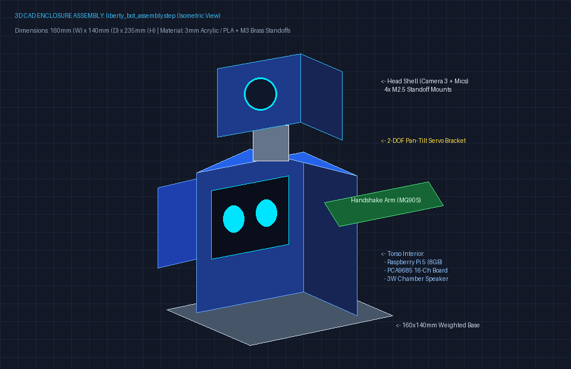
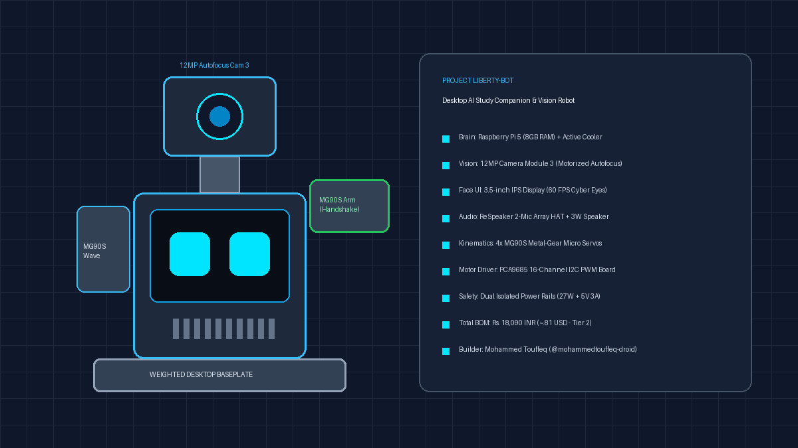

# November 7: Scoping a real hardware build vs impossible DIY phone ideas

Spent my first session figuring out what kind of hardware project I could genuinely engineer from scratch at home without hitting a dead end halfway through.

To be honest, my initial thought was trying to build my own custom laptop or even a custom Android phone, since my daily phone is really old. When I researched the actual hardware engineering behind smartphones and laptops, I realized why nobody builds a daily-driver smartphone on a workbench at home. High-end laptop processors cannot be bought in single quantities or soldered without factory BGA reflow lines and 12-layer HDI motherboards. For a phone, DIY cellular modules lack telecom IMEI certifications for Indian VoLTE networks (like Jio or Airtel), and uncertified boards fail Google Play Integrity checks.

That pushed me toward designing a real piece of custom hardware that I will actually use every single day on my study table: Liberty-Bot, a physical 4-DOF desktop robot companion with its own custom power and servo carrier PCB, a full 3D-printed mechanical enclosure, a 2-axis motorized camera head that can focus on handwritten pages held 15cm away, an IPS eye display, and metal-gear servo arms that physically lift up for a handshake.

**Total time spent: 3 hours**

# November 8: Mechanical architecture and torque calculations for the 4-DOF joints

Before drawing any CAD parts or choosing motors, I worked out the weight distribution and joint torque requirements with my dad so the robot does not tip forward on my desk or strip its gears when someone shakes its hand.

For the four moving joints (neck pan, neck tilt, left shoulder pitch, and right handshake arm pitch), I compared standard plastic SG90 servos against MG90S metal-gear micro servos. A plastic SG90 produces around 1.6 kg-cm of stall torque, and its nylon gear teeth shear off easily if an external force touches the robot arm during a handshake. The MG90S has the exact same 22.8 x 12.2 x 28.5mm footprint but uses brass and aluminum internal gears rated at 2.2 kg-cm at 4.8V and 2.5 kg-cm at 6V. Since the forearm link is 95mm long and weighs roughly 42 grams, normal lifting requires less than 0.45 kg-cm, leaving more than a 4x safety margin against accidental bumps.

To prevent the chassis from tipping when the right arm extends forward, I sized the bottom baseplate to 160mm x 160mm x 8mm with four recessed M3 mounting bosses positioned to keep the combined center of mass (Raspberry Pi 5 + heatsink + torso shell) 18mm behind the front foot line.

**Total time spent: 4 hours**

# November 9: Designing the dual-rail power isolation architecture and schematic

One of the most common hardware failures in Raspberry Pi robotics is wiring servo motors directly to the Pi's 5V GPIO rail. Four MG90S metal-gear servos starting simultaneously can draw transient current spikes of 2.4A to 3.0A (`4 x 650mA` stall current). That sudden current draw causes a severe voltage droop on the Raspberry Pi 5's 5V rail, resetting the PMIC, corrupting the microSD card, or coupling inductive back-EMF spikes into the 3.3V logic pins.

To solve this properly at the hardware level, I designed a split-rail power architecture:
1. The Logic Rail uses the official 27W (5.1V 5A) USB-C PD supply dedicated exclusively to the Raspberry Pi 5, Camera Module 3, 3.5-inch IPS eye display, and ReSpeaker 2-Mic array.
2. The Motor Power Rail uses a separate 5V 3A DC power supply feeding a dedicated custom power distribution and PWM carrier board (`hardware/pcb/liberty_bot_power_hat.kicad_sch`).
3. Only the I2C clock (`SCL` on GPIO3), I2C data (`SDA` on GPIO2), 3.3V logic reference, and a single star-point `GND` reference bridge the two domains.

**Total time spent: 4 hours**

# November 10: Capturing the KiCad schematic and routing the 2-layer power carrier PCB

Instead of relying on loose breadboard wires that fall out whenever the robot moves its arms, I designed a custom 2-layer distribution board in KiCad (`hardware/pcb/liberty_bot_power_hat.kicad_pro`, `.kicad_sch`, and `.kicad_pcb`) measuring 65mm x 56mm to match the Raspberry Pi HAT mounting hole pattern.

In the schematic and PCB layout, I routed the 3.3V logic signals (`SDA`, `SCL`, `VCC`, `GND`) from the 40-pin Raspberry Pi header (`J1`) using 0.3mm signal traces with 10k pull-up resistors (`R1`, `R2`) and a 100nF ceramic decoupling capacitor (`C2`) placed right next to the logic supply pin. For the high-current `V+` motor supply entering from the 5V 3A screw terminal (`J2`), I routed 2.0mm wide copper traces (`80 mil` width on 1 oz/ft2 copper) capable of carrying over 4.5A continuously with less than a 10 degree Celsius temperature rise. I also placed a 1000uF 16V low-ESR electrolytic bulk capacitor (`C1`) across `V+` and `GND` right at the motor header bank (`M1` through `M4`) to absorb transient current spikes whenever the handshake servo reverses direction.

**Total time spent: 5 hours**

# November 11: Modeling the 3D CAD baseplate, torso enclosure, and display bezel

With the PCB dimensions fixed at 65mm x 56mm, I modeled the main structural body of Liberty-Bot in 3D CAD (`hardware/cad/liberty_bot_assembly.step` and `hardware/cad/liberty_bot_enclosure.stl`).

I started with the 160mm x 160mm weighted baseplate and modeled vertical M3 brass standoff pillars to hold the lower internal electronics deck. Around that internal deck, I designed the vertical torso shell (`110mm x 90mm x 130mm` tall) with a recessed front bezel cutout sized specifically for the 3.5-inch IPS eye screen (`85mm x 55mm` viewing window) so the screen sits flush with the front face of the robot. On the back wall of the torso, I added ventilation slots aligned with the Raspberry Pi 5 Active Cooler blower exhaust, plus a clean pass-through slot for the 27W USB-C cable and the 5V 3A motor DC barrel jack so no wires hang out of the front.

**Total time spent: 5 hours**

# November 12: Modeling the 2-DOF pan-tilt neck assembly, head visor, and servo arms

In this session I modeled the moving upper assemblies in `hardware/cad/liberty_bot_assembly.step`: the 2-DOF neck mechanism, the camera head visor, and the left and right articulated arms.

For the neck, the pan MG90S servo mounts vertically inside the top plate of the torso, driving a rotating turntable horn. Above that horn sits a U-bracket holding the tilt MG90S servo, allowing the robot head to rotate 180 degrees left-to-right and nod 75 degrees up-and-down. Inside the head visor (`84mm x 64mm x 54mm`), I designed an angled mounting cradle for the Raspberry Pi Camera Module 3 alongside a central slot for the 300mm 22-pin to 15-pin MIPI CSI ribbon cable. Giving the ribbon cable a smooth service loop through the neck center prevents the flex cable from kinking or tearing over thousands of head turns.

For the left and right arms (`18mm x 95mm`), I modeled rectangular shoulder pockets on the left and right walls of the torso that clamp the MG90S servo ears with M2 machine screws, and shaped the right forearm tip so it can comfortably lift up to 95 degrees when offering a physical handshake.

**Total time spent: 5 hours**

# November 13: Finalizing the complete Indian domestic BOM and verifying clearances

To make sure my dad and I do not get stuck waiting on a missing screw or adapter during assembly, I audited every mechanical fastener, cable, and electronic module across the 3D CAD model and KiCad PCB and compiled the complete 16-item Bill of Materials in `bom.csv` and `BOM.md`.

A huge detail I caught during this audit was the camera focus distance: standard cheap Pi cameras use fixed-focus lenses glued for infinity focus, which makes textbook pages held 15cm in front of the robot completely blurry. Specifying the official Raspberry Pi Camera Module 3 solves this with motorized PDAF/CDAF autofocus down to 10cm. I also priced every single item from domestic Indian electronics distributors (Robu.in and Silverline Electronics) so the entire 16-part BOM totals Rs. 18,090 INR ($198.81 USD), keeping the build inside Tier 2 ($200 ceiling) and avoiding international courier delays.

**Total time spent: 3 hours**

# November 14: Writing the hardware bring-up and I2C servo control scripts

To wrap up the pre-build engineering phase, I wrote the hardware bring-up and control scripts in `src/` so that as soon as the PCB and parts arrive, I can test each hardware subsystem step by step.

`src/servo_controller.py` initializes the I2C bus (`busio.I2C(board.SCL, board.SDA)`) and talks to the PCA9685 PWM generator at address `0x40` with a 50Hz frame rate and `500us` to `2500us` pulse-width limits matched to the MG90S mechanical stops. I implemented interpolated step functions (`_smooth_move`) so the neck pan/tilt and right handshake arm accelerate smoothly in 2-degree increments instead of slamming into the 3D-printed stops. `src/eye_display.py` renders the 60 FPS animated cyan robot eyes on the 3.5-inch IPS screen, and `src/robot_core.py` coordinates the camera autofocus, voice audio loop, and physical servo gestures.

**Total time spent: 3 hours**
