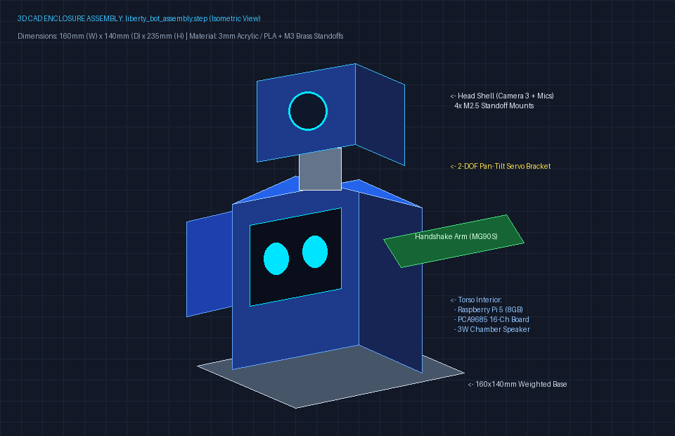
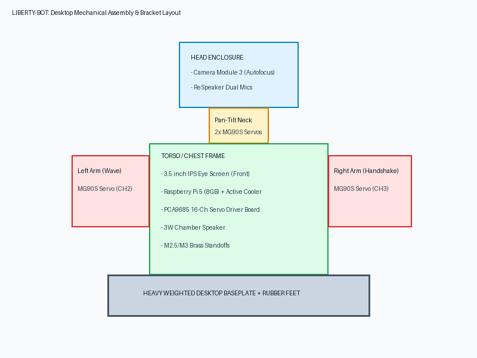
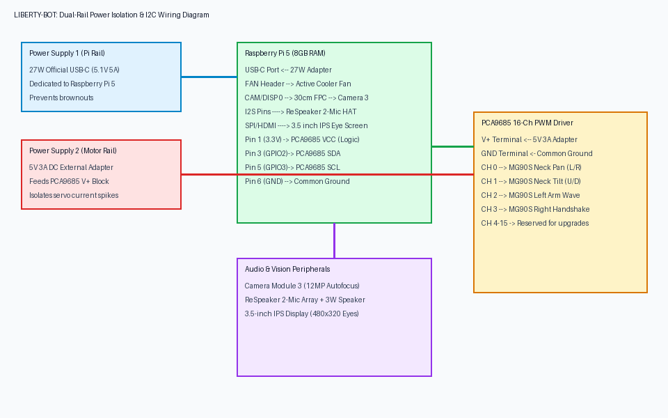

# Project Liberty-Bot

## Why I am building this robot

For a long time, I wanted to build a piece of hardware that actually sits on my study table and feels alive. At first, I was thinking about building a full DIY laptop or even a custom phone, because my current phone is pretty old and slow. But the more I researched how smartphones and laptops work under the hood, I hit a lot of real-world walls. Phones need proprietary cellular modems, telecom IMEI registrations, and Google certification just to run basic apps, and custom laptop motherboards need multi-layer high-speed routing that you simply cannot assemble at home.

That made me rethink what I actually wanted. When I am sitting at my study desk working on college subjects or brainstorming ideas, I do not just want another flat screen or a browser tab. I want a physical robot standing right there on my table that can see me, look at my notebook when I get stuck on a problem, talk to me out loud with a real voice, and move around. If I ask it what time it is, or ask it to explain a concept I am studying, it should answer me directly. If I hold up a page from my book with a problem on it, it should be able to focus on the page, read it, and walk me through the solution. And if I tell it to shake my hand, it should actually lift its arm up for a handshake.

I named this project Liberty-Bot. My father knows how to handle hardware assembly and mechanical fitting, so he is going to help me put the physical frame, brackets, and wiring together once the parts arrive. My goal is to build a solid base robot that works reliably all day on my desk, and designed in a way where I can keep modifying and upgrading it over the next few years with more motors, sensors, or wheels.

## How the robot works in practice

Liberty-Bot is a stationary desktop robot built on a heavy baseplate so it does not tip over when its arms move. The whole system is built around a Raspberry Pi 5 with 8GB of RAM. I picked the 8GB version specifically because running camera capture, speech recognition, audio output, and an animated face screen all at the same time takes a lot of memory, and I want this robot to run smoothly without freezing up. Since it will stay turned on at my desk for hours while I study, I am putting the official active cooler fan on the Pi 5 so the processor never thermal throttles.

For the robot's vision, I chose the Raspberry Pi Camera Module 3 with autofocus. This was a really important detail for me. Earlier, I looked at cheaper fixed-focus camera modules, but those are set to focus at infinity and make everything blurry if you hold a piece of paper closer than half a meter. Because I want to hold my handwritten notes or textbook pages right in front of the robot's face (around 15 to 20 centimeters away), having mechanical autofocus on the camera means it can actually lock onto small text clearly. I am also using a longer 30cm flexible camera ribbon cable so the wire has plenty of slack when the robot turns its head left, right, up, and down.

For its face, the robot uses a 3.5-inch IPS color screen mounted on the front enclosure. Instead of looking like a blank box, this screen draws two big animated digital eyes. When the robot is listening to me, the eyes look straight ahead and blink naturally. When it is processing a question or reading a page from my book, the eyes shift into a thinking animation, and when it greets me or shakes my hand, the eyes change expression.

For hearing and speaking, I am mounting a ReSpeaker 2-Mic Pi HAT along with a 3W enclosed chamber speaker. A normal tiny buzzer or cheap microphone struggles when there is room noise or a ceiling fan running overhead. The dual-microphone array helps pick up my voice clearly from across my desk without me having to lean in close, and the 3W speaker makes sure the voice sounds clear and loud enough to understand easily.

For physical movement, the robot has four degrees of freedom driven by four MG90S micro servo motors. Two of the servos are mounted in a pan-and-tilt bracket system for the neck, allowing the head (which holds the camera) to look left and right as well as nod up and down. The other two servos control the left and right arms. When I say "shake hands" or wave at it, the right arm servo rotates up so I can physically shake its hand. I specifically avoided the cheap blue SG90 servos because they have thin plastic gears inside that strip and break very easily if you accidentally bump the robot's arm. The MG90S servos use metal gears inside, so they are much tougher and will last for years of modifications.

## Keeping the electronics safe from burning out

One of the biggest mistakes people make when building their first Raspberry Pi robot is wiring servo motors directly to the Pi's 5V pin. When four metal-gear servos suddenly start moving at the same time, they draw a huge spike of current. That sudden power draw causes the voltage on the Raspberry Pi to drop, which makes the Pi crash, reboot, or corrupt the SD card, and the electrical back-EMF from the motors can even damage the GPIO pins permanently.

To make sure my Raspberry Pi 5 stays completely safe, I designed the power system with two completely separate power adapters. The Raspberry Pi 5 gets its own official 27W USB-C power supply. Then, for the motors, I am using a dedicated PCA9685 16-channel PWM servo driver board connected to a separate 5V 3A DC power adapter. The Raspberry Pi only sends tiny I2C control signals (through the SDA and SCL pins) to tell the PCA9685 board what angle to move the motors to, while all the heavy motor current comes from the second adapter. Even better, because the PCA9685 board has 16 channels and I am only using 4 channels right now, I have 12 empty slots left over. That means whenever I want to upgrade Liberty-Bot in the future with moving fingers, waist rotation, or wheels, I can just plug new motors straight into the board without buying new driver hardware.

## 3D CAD Assembly, Mechanical Layout, and Wiring Diagrams

## Repository Contents

* `hardware/cad/liberty_bot_assembly.step` and `hardware/cad/liberty_bot_enclosure.stl` contain the 3D CAD assembly model and printable enclosure geometry for the baseplate, torso, pan-tilt neck, head visor, and MG90S servo arm mounts.
* `hardware/pcb/liberty_bot_power_hat.kicad_pro`, `.kicad_sch`, and `.kicad_pcb` contain the KiCad schematic and 2-layer distribution board layout for isolating the 5V 3A servo power rail from the Raspberry Pi 5 logic pins.
* `bom.csv` and `BOM.md` contain the complete list of all 16 parts, screws, cables, and power supplies needed so nothing is missing during assembly, along with local Indian vendor links and pricing.
* `CIRCUIT_DIAGRAM.md` explains the exact pin connections between the Raspberry Pi 5, the PCA9685 servo board, the audio module, camera, and power supplies.
* `JOURNAL.md` tracks my design choices, why earlier ideas were dropped, and how I planned out the build.
* `src/` contains the initial Python scripts for controlling the servo gestures, drawing the eyes, and running the voice and camera loop.
