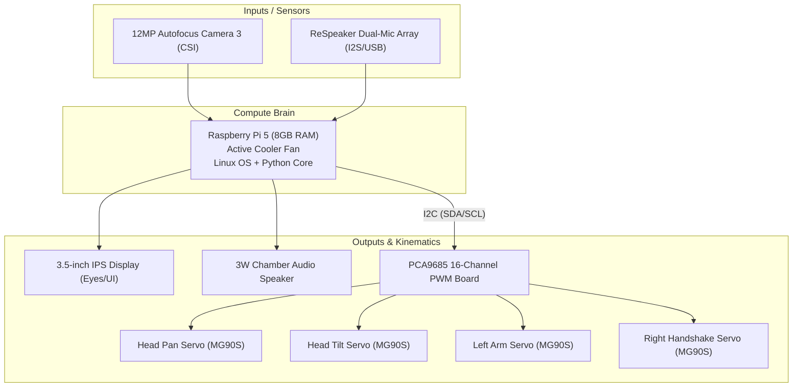

# Project LIBERTY-BOT 🤖
> **An Open-Source Desktop AI Companion Robot with Multimodal Vision, Real-Time Voice, and Expressive Servo Kinematics.**

---

## 📌 Project Overview
**LIBERTY-BOT** is an open-source, interactive desktop AI companion designed to sit on a student's study desk. Powered by a **Raspberry Pi 5 (8GB)**, it functions as a tireless personal study mentor, conversational partner, and robotic assistant.

### 🌟 Key Features:
1. **Multimodal AI Vision (The Eyes)**: Uses a 12MP Autofocus Camera Module 3 to read study material, recognize handwritten formulas/problems, and visually inspect real-world objects.
2. **Interactive Natural Voice (Ears & Mouth)**: Equipped with a ReSpeaker Dual-Microphone Array and a 3W chamber speaker for hands-free conversations in both English and Hindi.
3. **Animated Digital Expressions (The Face)**: A 3.5-inch IPS display renders dynamic, expressive cybernetic eyes (happy, curious, thinking, alerting).
4. **Physical Kinematics (Hands & Neck)**: 4 high-torque metal-gear micro servos (MG90S) allow the robot to nod, tilt its head, track faces, and extend its arm for physical handshakes and gestures.
5. **Modular & Safe Architecture**: Driven by a PCA9685 16-channel PWM driver board with dual isolated power rails to prevent brownouts and safeguard the Raspberry Pi 5.

---

## 📐 System Architecture

---

## 🛠️ Software Stack
* **Operating System**: Raspberry Pi OS (Debian 64-bit)
* **Vision Processing**: Python 3 + OpenCV + V4L2 Camera Pipeline
* **Voice In/Out**: PyAudio / SpeechRecognition + Edge-TTS / Piper Local Neural TTS
* **AI Intelligence Brain**: Gemini Multimodal API / Local Vision-Language Models (VLM)
* **Motor Control**: Adafruit PCA9685 I2C Python Library
* **GUI / Eyes Animation**: Pygame / Tkinter hardware-accelerated animated eye canvas

---

## 👨‍💻 Author & Maintainer
* **Author**: Mohammed Touffeq
* **Handle**: `@mohammedtouffeq-droid`
* **Community**: Hack Club / Hack Club Forge
* **Target Budget**: ~$250 USD / ₹21,000 INR (Zero-Cost Educational Hardware Grant)
